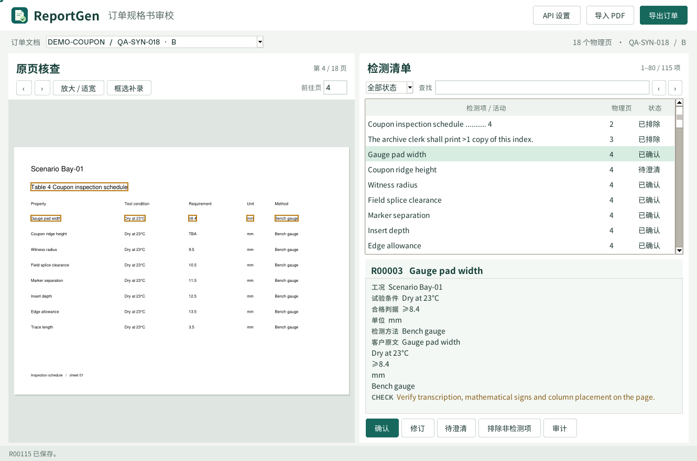
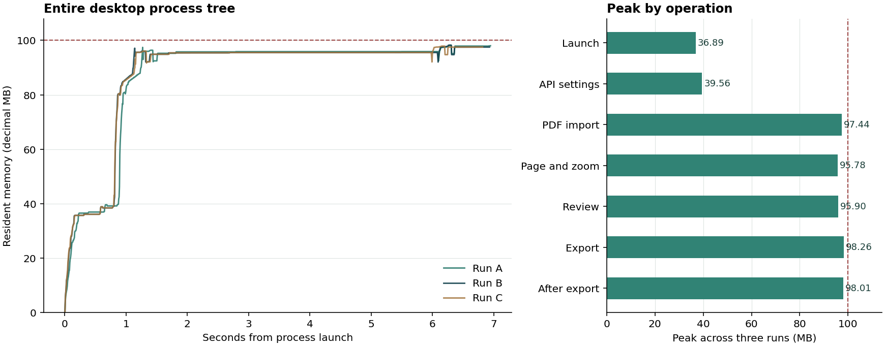

# 订单规格书审校桌面版验证报告

2026 年 11 月 26 日，基线为 `work@764503a`。本轮 **65 项 pytest 全部通过**。三次独立冷启动都完成了 18 页混合 PDF 的图形界面审校和导出。Linux 整个应用进程树的最高常驻内存为 **98,263,040 字节**。本地构建的 Windows x64 绿色 ZIP 为 **42,838,650 字节**。

## 业务验收

| 实际检查 | 结果 |
| --- | --- |
| 噪声、风险与审计 | 带 CHECK 的目录或行政候选可以说明原因后排除。未处置的风险继续拦截。重新打开排除项需要重新审校。每轮界面实测得到 112 项确认、2 项排除、1 项 TQ，并完成一次有依据的字段修订 |
| 视觉 API | GUI 可保存地址、模型和认证头。用真实 HTTP 请求检验文本连通性和图像传输，并在本机非回环私网网卡验证自定义路径和认证头。自动筛选测试跳过封面、目录和修订记录。手选扫描页时 18 页中只发送 1 页 |
| 图像抽取 | 无本地 OCR 也可从图像生成逐行转录，接受近似区域、整页证据及围栏 JSON。测试覆盖跨页工况、部件、表号、脚注和交叉引用。相邻行脚注隔离。模型与本地转录冲突、可疑占位和单页截断均保留人工核查路径 |
| 判据与基准 | 显式高温进入适用的高温基准，并提示核对实际最高工况。压痕缺温度、无型别的剥离单位比例或量纲异常，以及冲击能量尺度均有独立用例。ISO 基准仅供对照。典型值、TBA、By Vendor、By Agreement 和表格横线的保护均有断言 |
| 实验室交付 | 实验室与现场表各 15 列，澄清表 17 列。逐行验证锁定英文原文、可读文号版次和物理页、条件与限值，以及三列解锁的空白填报格。独立检查 XLSX 关系文件，没有外部链接。LibreOffice 单独打开实验室模板并成功转换为 ODS |
| 旧报告与数据边界 | 27 项原流程测试和 38 项订单测试通过。另将基础提交的原始测试文件原样放在忽略目录复跑，27 项通过。核对既有 8 份标准预置、3 份本地 Word 模板及共享自定义模板状态。本轮修改集中在订单模块、其测试和交付工具。原报告的构建入口 `tools/build.py` 与基础提交同字节 |

与 `main` 相比，基线提交已将历史说明和公开测试中的真实样例标识替换为虚构标识，并让非 Windows 测试可以延后加载 Office COM。本轮沿用这些调整。客户原件与私有离线复核输出只在私有目录，公开 PDF 样例由生成器即时创建。

## 实际桌面与内存



[原页放大截图](order-desktop/detail.png) · [API 配置及实测连通截图](order-desktop/api.png)

Linux 使用 Debian 13、CPython 3.13.5、Tk 8.6.16 和 X11。产品解释器只安装 `requirements-orders.txt`。每次从新订单库启动，使用 18 页公开生成的样例，含封面、目录、行政正文、14 页检测表和 1 页纯图像。驱动程序从另一进程操作真实 Tk 控件，完成服务配置与文本测试、文件选择和预览、导入、翻页、缩放、逐项审校、查看审计和导出三个文件。另在真实 X11 窗口上验证窗口图标属性与托盘停靠。

用独立进程以 5 ms 的目标间隔采样，统计主进程和所有后代进程的 RSS 之和，同时读取 Linux 内核的 `VmHWM` 捕获采样间隔内的主进程峰值。三轮均为一个应用进程。X 显示服务、自动化驱动、截图工具和模拟服务属于测试基础设施，独立于应用进程树。应用未启动浏览器、模型或本地 OCR。每次用 `prlimit` 将目标进程虚拟地址空间限制为 8,000,000,000 字节。实际宿主的 cgroup 上限为 32 GiB。下表使用十进制 MB。

| 阶段 | 三轮最高 RSS（MB） | 阶段结束 RSS 范围（MB） |
| --- | ---: | ---: |
| 桌面启动 | 36.89 | 36.06–36.89 |
| API 配置与测试 | 39.56 | 38.59–39.49 |
| 导入及预览 | 97.44 | 92.09–92.43 |
| 翻页与缩放 | 95.78 | 95.40–95.78 |
| 逐条审校 | 95.90 | 95.52–95.90 |
| 导出 | 98.26 | 95.13–98.26 |
| 导出后驻留 | 98.01 | 97.54–98.01 |

三次峰值分别为 98,127,872、98,263,040 和 97,918,976 字节，采样数分别为 1,126、1,118 和 1,119。这些结果对应上述文档、分辨率和操作序列。更大扫描页、并发应用和目标 Windows 机器的实际工作集需分别实测。



[逐样本 CSV](order-desktop/memory.csv) · [逐轮实测 JSON](order-desktop/measurements.json)

## Windows 便携包

| 项目 | 实测 |
| --- | --- |
| ZIP 大小 | 42,838,650 字节，限制 50,000,000 字节 |
| 解压 | 1,514 个文件，合计 102,241,696 字节 |
| 本地交付 ZIP 的 SHA-256 | `4c232e0a5856593d3fdda140480727351264ff7eb893613dab569606fbbfa92f` |
| 运行时 | Windows x64 CPython 3.12.10、Tcl/Tk、PyMuPDF 1.26.6、XlsxWriter 3.2.9、Pillow 11.3.0、PyYAML 6.0.3。补齐并校验 PDF 绑定所需的应用本地 MSVC++ DLL |
| 兼容层验证 | 在 Linux Wine 10 中直接运行包内 Windows 解释器。验证带中文及空格路径的 BAT、实际 Tk 窗口、原页显示、原生托盘、DPAPI 密钥往返、PDF 导入与 JSON/Excel 导出 |
| 实机待验 | Windows 10 1903、8 GB、无独显办公机的原生工作集和翻页响应，Explorer 任务栏和托盘外观、DPI 缩放及注册表写入跟踪。GUI 使用应用内文件选择器，配置、订单和导出均写便携目录。第三方生产模型的转录质量、授权和部署参数须用实际服务验证 |

```text
ReportGen/
  Start-ReportGen.bat
  使用说明.md  NOTICE.txt  sources.json  order-review.example.yaml
  app/launch.pyw
  app/src/cyct_report/orders/       桌面、规则、原文证据、图标和字体
  app/presets/standards/           只读对照文件
  runtime/                        pythonw.exe、Python DLL、C++ 运行库
    DLLs/  Lib/  tcl/              Tk、PDF、Excel 等依赖
  private/                        首次运行时创建
  exports/                        首次按默认位置导出时创建
```

## 复现

以下命令在源码根目录执行。Linux 产品环境用带 Tk 8.6 的系统 Python，构建 Windows 包的主机解释器用 CPython 3.12，Linux 安装 msitools。自动化驱动使用独立解释器，安装 `psutil`、`python-xlib`、`Pillow`、`openpyxl` 和 `PyMuPDF`，桌面目标解释器只需产品依赖。

```sh
work/desktop-test-venv/bin/python -m pytest -q
work/desktop-test-venv/bin/python -m pytest -q work/legacy-verbatim
for run in a b c; do
  work/desktop-observer/bin/python tools/smoke_orders_desktop.py --python work/orders-runtime/bin/python "work/acceptance-$run"
done
python tools/build_orders_portable.py --msiextract /tmp/reportgen-desktop-tools/usr/bin/msiextract
```

图形测试使用私有 Xvfb 显示器，分辨率 1440 × 1000，设置对应的 `DISPLAY` 和 `XAUTHORITY`。每轮要求一个新的输出目录。使用标准安装的 msitools 时可省略 `--msiextract`。Windows 端也可在新解压目录中使用下列命令验证实际运行库和启动器。

```powershell
.\ReportGen\runtime\python.exe -B tools\verify_orders_windows.py
```
